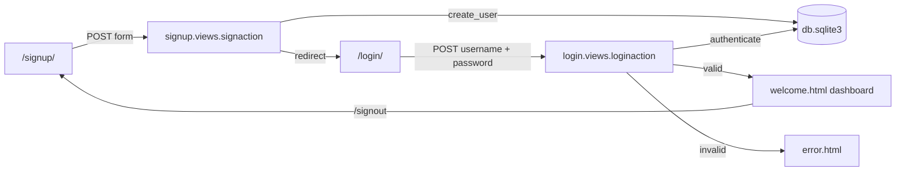

# 📚 Voxly – English Learning Platform

**Voxly** is an English language learning platform built with Django. Learners can sign up, log in, and reach a dashboard with reading, writing, listening, speaking and quiz sections.

---

### 🧰 Technologies Used

* **Backend**: Python, Django
* **Frontend**: HTML, CSS, JavaScript
* **Database**: SQLite (Django's default, no setup needed)
* **Auth**: Django's built-in `django.contrib.auth` user model

---

### 📂 Project Structure

```
Voxly-language-learning-platform/
├── DJANGO PROJECT/website/     ← the Django app (run all commands from here)
│   ├── manage.py               Django CLI (runserver, migrate, ...)
│   ├── requirements.txt        Python dependencies
│   ├── db.sqlite3              SQLite database
│   ├── website/                Project config: settings.py, urls.py, wsgi/asgi
│   ├── signup/                 Sign-up view (creates a Django user)
│   ├── login/                  Login and sign-out views
│   ├── template/               HTML templates (login, signup, welcome, error, quiz, profile)
│   └── static/                 Images used by the templates
├── index.html, login.html, signup.html,
│   dashboard.html, Profile.html, quiz.html   ← static front-end prototype (no backend)
└── Images/                     Images for the static prototype
```

---

### 🔀 How It Works



| URL        | View          | Purpose                                     |
| ---------- | ------------- | ------------------------------------------- |
| `/signup/` | `signaction`  | Registration form; redirects to login       |
| `/login/`  | `loginaction` | Login form; shows dashboard or error page   |
| `/signout` | `signout`     | Logs out and redirects to sign-up           |
| `/admin/`  | Django admin  | Manage users (needs a superuser)            |

> ℹ️ There is no page at `/`. Start at `/signup/` or `/login/`.

---

### ⚙️ Installation

**Prerequisites:**

* Python 3.10+
* pip

**Steps:**

1. **Clone the repository:**

   ```bash
   git clone https://github.com/hbhat-b/voxly-language-learning-platform.git
   cd voxly-language-learning-platform
   ```

2. **Move into the Django project folder.** Every command after this is run here, because the template path in `settings.py` is relative to this folder:

   ```bash
   cd "DJANGO PROJECT/website"
   ```

3. **Create and activate a virtual environment (recommended):**

   ```bash
   python -m venv venv
   source venv/bin/activate     # On Windows: venv\Scripts\activate
   ```

4. **Install the dependencies:**

   ```bash
   pip install -r requirements.txt
   ```

5. **Apply migrations** (creates or updates `db.sqlite3`):

   ```bash
   python manage.py migrate
   ```

6. **(Optional) Create an admin user** for `/admin/`:

   ```bash
   python manage.py createsuperuser
   ```

7. **Start the development server:**

   ```bash
   python manage.py runserver
   ```

8. **Open the app** at [http://localhost:8000/signup/](http://localhost:8000/signup/), create an account, then log in.

> 💡 **Static prototype:** the HTML files in the repo root (`index.html`, `dashboard.html`, etc.) can be opened directly in a browser without Django.

---

### 🚀 Quick Commands

Run from `DJANGO PROJECT/website`:

| Action         | Command                                   |
| -------------- | ----------------------------------------- |
| Install deps   | `pip install -r requirements.txt`         |
| Migrate DB     | `python manage.py migrate`                |
| Create admin   | `python manage.py createsuperuser`        |
| Run server     | `python manage.py runserver`              |
| Network access | `python manage.py runserver 0.0.0.0:8000` |

> For network access, also add your machine's IP to `ALLOWED_HOSTS` in `website/settings.py`.

---

### ⚠️ Known Limitations

* Links inside the dashboard (`welcome.html`) to the profile, quiz and resources pages use local file paths and are not wired to Django URLs yet.
* The first name, last name and gender fields on the sign-up form are not saved.
* `settings.py` uses `DEBUG = True` and a hard-coded `SECRET_KEY`. Use it for local development only.
